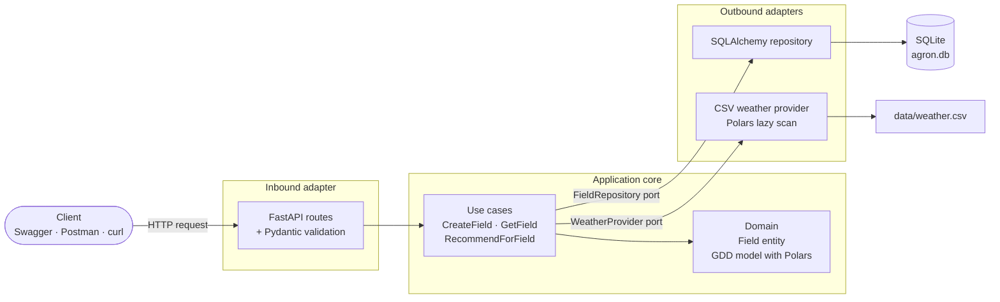
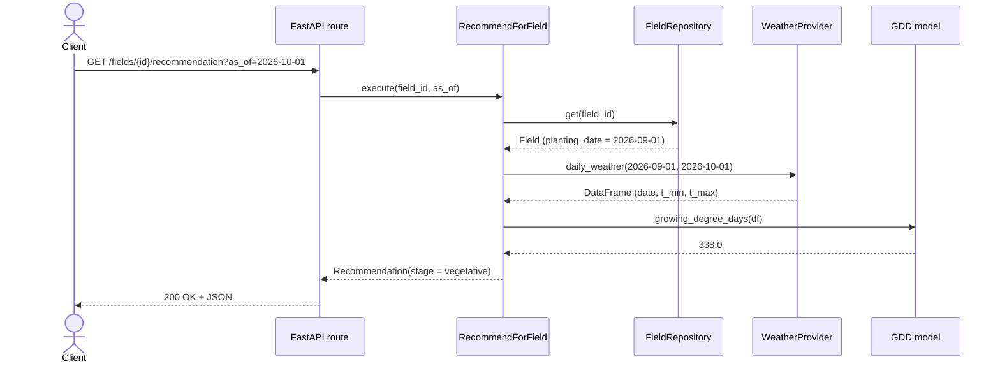

<div align="center">

# 🌱 Agron

**Turning an agronomic model into a production-ready API.**

Agron registers farm fields and estimates the current crop stage from weather data,<br>
using the **growing degree days** model, the method agronomists use to track how a crop develops with temperature.

[](https://www.python.org/)
[](https://fastapi.tiangolo.com/)
[](https://docs.pydantic.dev/)
[](https://www.sqlalchemy.org/)
[](https://pola.rs/)
[](https://docs.astral.sh/uv/)
[](https://docs.astral.sh/ruff/)
[](https://docs.pytest.org/)

🇺🇸 English · [🇧🇷 Português](README.pt-BR.md)

</div>

---

## 📌 What Agron does

In agriculture, a crop does not develop by calendar days but by **accumulated heat**. Agronomists measure this with **growing degree days (GDD)**: for each day, how much the average temperature rose above a base temperature below which the plant does not grow.

Agron takes that scientific model and serves it as an API:

1. 🗺️ **Register a field.** A field is a plot of farmland with a crop, an area in hectares and a planting date.
2. 🌦️ **Read the weather.** Daily minimum and maximum temperatures come from a weather dataset (a CSV file in this version).
3. 🧮 **Run the model.** Polars adds up the growing degree days from the planting date to the requested date.
4. 🌾 **Answer with the crop stage.** The accumulated GDD is mapped to a stage: `emergence`, `vegetative`, `flowering` or `maturity`.

> This is the everyday job of a **domain engineer** in agtech: taking a model built by scientists and turning it into a reliable, tested service that other systems can call.

### The model

```
daily GDD = max(0, (t_min + t_max) / 2 − base_temperature)
```

The base temperature is **10 °C**. Days colder than the base count as zero, never negative.

| Accumulated GDD | Crop stage |
| --- | --- |
| below 100 | `emergence` |
| 100 to 699 | `vegetative` |
| 700 to 1299 | `flowering` |
| 1300 and above | `maturity` |

> ⚠️ The thresholds are illustrative for this project, not real agronomic recommendations.

---

## 🔄 How a request flows



**A recommendation step by step:**



---

## 🏛️ Architecture

Agron uses **hexagonal architecture (ports and adapters)**. The domain and the use cases know nothing about FastAPI, databases or files. They depend only on **ports**, and **adapters** implement them.

| Layer | Folder | Responsibility |
| --- | --- | --- |
| Domain | `src/agron/domain/` | `Field` entity and the GDD model. Pure Python and Polars, no framework. |
| Application | `src/agron/application/` | Use cases and ports (`FieldRepository`, `WeatherProvider`). |
| Inbound adapter | `src/agron/adapters/inbound/` | FastAPI routes and Pydantic schemas. Translate HTTP to use cases. |
| Outbound adapters | `src/agron/adapters/outbound/` | SQLAlchemy repository and CSV weather reader. |
| Composition | `src/agron/dependencies.py` | Wires each port to its adapter with FastAPI `Depends`. |

**Why it matters:** the agronomic model can change, the database can move from SQLite to PostgreSQL, or the weather can come from an external API, all without touching the domain. In tests, the adapters are swapped for in-memory fakes through `app.dependency_overrides`.

---

## 🧰 Tech stack

| Technology | Where it is used |
| --- | --- |
| **Python 3.13** | Language of the whole project. |
| **FastAPI** | HTTP API, routing, dependency injection (`Depends`) and automatic OpenAPI/Swagger docs. |
| **Uvicorn** | ASGI server that runs the FastAPI app. |
| **Pydantic** | Request and response schemas, with validation (for example `area_ha > 0` returns 422). |
| **SQLAlchemy 2.0** | ORM for the `fields` table, behind the `FieldRepository` port. |
| **Alembic** | Database migrations generated from the SQLAlchemy models. |
| **SQLite** | Local database, a single `agron.db` file with no server to install. |
| **Polars** | Reads the weather CSV lazily and computes the growing degree days. |
| **pytest + httpx** | Unit tests for the model and API tests with FastAPI's `TestClient`. |
| **uv** | Installs Python and dependencies, manages the virtual environment and runs commands. |
| **Ruff** | Linting and formatting. |

---

## 📁 Project structure

```
agron/
├── data/
│   └── weather.csv              # daily weather (model input)
├── make_weather.py              # regenerates the sample weather CSV
├── migrations/                  # Alembic migrations
├── src/agron/
│   ├── domain/
│   │   ├── models.py            # Field entity
│   │   └── agronomy.py          # growing degree days model (Polars)
│   ├── application/
│   │   ├── ports.py             # FieldRepository, WeatherProvider
│   │   └── use_cases.py         # CreateField, GetField, RecommendForField
│   ├── adapters/
│   │   ├── inbound/api.py       # FastAPI routes + Pydantic schemas
│   │   └── outbound/
│   │       ├── db.py            # SQLAlchemy repository
│   │       └── weather_csv.py   # CSV weather provider (Polars)
│   ├── dependencies.py          # wires ports to adapters
│   └── main.py                  # FastAPI app
├── tests/
├── alembic.ini
└── pyproject.toml
```

---

## 🚀 Running locally

### Prerequisites

- **Git**
- **uv**, which also installs the right Python version for you:

```bash
# macOS / Linux
curl -LsSf https://astral.sh/uv/install.sh | sh

# Windows (PowerShell)
powershell -ExecutionPolicy ByPass -c "irm https://astral.sh/uv/install.ps1 | iex"
```

### 1. Clone the repository

```bash
git clone https://github.com/LucasBrum/agron.git
cd agron
```

### 2. Install the dependencies

```bash
uv sync
```

This creates a `.venv` folder with Python 3.13 and every library in `uv.lock`.

### 3. Create the database

```bash
uv run alembic upgrade head
```

This creates `agron.db` with the `fields` table.

### 4. Start the API

```bash
uv run uvicorn agron.main:app --reload
```

Open **http://127.0.0.1:8000/docs** for the interactive Swagger UI.

> The sample weather file `data/weather.csv` is already in the repository and covers 2026-09-01 to 2026-12-29. To regenerate it, run `uv run python make_weather.py`.

---

## 🧪 Trying the API

**Create a field**

```bash
curl -X POST http://127.0.0.1:8000/fields \
  -H "Content-Type: application/json" \
  -d '{"name": "Field 1", "crop": "soy", "area_ha": 50, "planting_date": "2026-09-01"}'
```

```json
{
  "name": "Field 1",
  "crop": "soy",
  "area_ha": 50.0,
  "planting_date": "2026-09-01",
  "id": "8705b4a2-fcce-4a80-b9a5-246a6f6b3a04"
}
```

**Get the crop stage on a date** (use the `id` returned above)

```bash
curl "http://127.0.0.1:8000/fields/<id>/recommendation?as_of=2026-10-01"
```

```json
{
  "field_id": "8705b4a2-fcce-4a80-b9a5-246a6f6b3a04",
  "as_of": "2026-10-01",
  "growing_degree_days": 338.0,
  "stage": "vegetative"
}
```

### Endpoints

| Method | Path | Description | Responses |
| --- | --- | --- | --- |
| `POST` | `/fields` | Register a field | `201`, `422` invalid body |
| `GET` | `/fields/{field_id}` | Get a field by id | `200`, `404`, `422` invalid id |
| `GET` | `/fields/{field_id}/recommendation?as_of=YYYY-MM-DD` | Growing degree days and crop stage on a date | `200`, `404` |
| `GET` | `/health` | Health check | `200` |

---

## ✅ Running the tests and the linter

```bash
uv run pytest -v
uv run ruff check .
uv run ruff format .
```

The API tests replace the database and the weather source with in-memory fakes through `app.dependency_overrides`, so they run fast and need no setup.

---

## 🗺️ Roadmap

- [ ] Reject recommendation dates before the planting date (422)
- [ ] PostgreSQL with Docker Compose
- [ ] Dockerfile for the API
- [ ] CI on GitHub Actions (Ruff + pytest on every push)
- [ ] Apache Airflow DAG to ingest daily weather and refresh recommendations
- [ ] Kubernetes manifests

---

<div align="center">

Built by **Lucas Brum** · [GitHub](https://github.com/LucasBrum) · [LinkedIn](https://www.linkedin.com/in/lucasbrum/)

</div>
