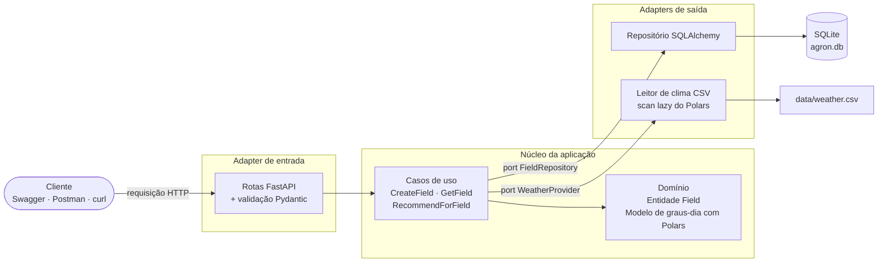
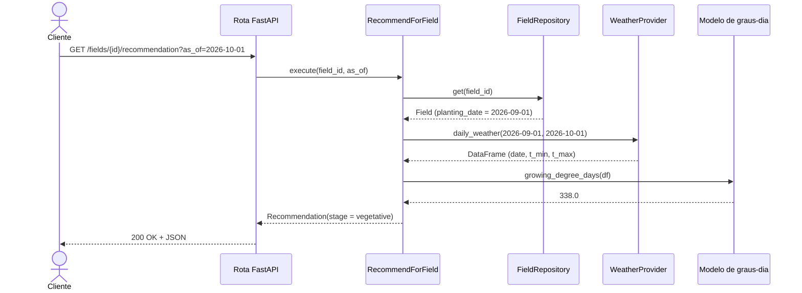

<div align="center">

# 🌱 Agron

**Transformando um modelo agronômico em uma API pronta para produção.**

O Agron cadastra talhões e estima a fase atual da cultura a partir de dados de clima,<br>
usando o modelo de **graus-dia (soma térmica)**, o método que agrônomos usam para acompanhar o desenvolvimento da planta pela temperatura.

[](https://www.python.org/)
[](https://fastapi.tiangolo.com/)
[](https://docs.pydantic.dev/)
[](https://www.sqlalchemy.org/)
[](https://pola.rs/)
[](https://docs.astral.sh/uv/)
[](https://docs.astral.sh/ruff/)
[](https://docs.pytest.org/)

[🇺🇸 English](README.md) · 🇧🇷 Português

</div>

---

## 📌 O que o Agron faz

Na agricultura, a planta não se desenvolve por dias de calendário, e sim por **calor acumulado**. Os agrônomos medem isso com a **soma térmica em graus-dia (GDD, *growing degree days*)**: para cada dia, quanto a temperatura média passou de uma temperatura base, abaixo da qual a planta não cresce.

O Agron pega esse modelo científico e o expõe como API:

1. 🗺️ **Cadastra um talhão.** Um talhão é uma área da fazenda com uma cultura, uma área em hectares e uma data de plantio.
2. 🌦️ **Lê o clima.** As temperaturas mínima e máxima de cada dia vêm de uma base de clima (um arquivo CSV nesta versão).
3. 🧮 **Roda o modelo.** O Polars soma os graus-dia da data de plantio até a data pedida.
4. 🌾 **Responde com a fase da cultura.** Os graus-dia acumulados viram uma fase: `emergence` (emergência), `vegetative` (vegetativa), `flowering` (floração) ou `maturity` (maturação).

> Esse é o trabalho do dia a dia de um **domain engineer** em agtech: pegar um modelo criado por cientistas e transformá-lo em um serviço confiável e testado, que outros sistemas podem chamar.

### O modelo

```
graus-dia do dia = max(0, (t_min + t_max) / 2 − temperatura_base)
```

A temperatura base é **10 °C**. Dias mais frios que a base contam zero, nunca negativo.

| Graus-dia acumulados | Fase da cultura |
| --- | --- |
| abaixo de 100 | `emergence` |
| de 100 a 699 | `vegetative` |
| de 700 a 1299 | `flowering` |
| 1300 ou mais | `maturity` |

> ⚠️ Os limites das fases são ilustrativos para este projeto, não são recomendações agronômicas reais.

---

## 🔄 Como uma requisição percorre o sistema



**Uma recomendação, passo a passo:**



---

## 🏛️ Arquitetura

O Agron usa **arquitetura hexagonal (ports and adapters)**. O domínio e os casos de uso não conhecem FastAPI, banco de dados nem arquivos. Eles dependem só de **ports**, e os **adapters** implementam esses ports.

| Camada | Pasta | Responsabilidade |
| --- | --- | --- |
| Domínio | `src/agron/domain/` | Entidade `Field` e o modelo de graus-dia. Python puro e Polars, sem framework. |
| Aplicação | `src/agron/application/` | Casos de uso e ports (`FieldRepository`, `WeatherProvider`). |
| Adapter de entrada | `src/agron/adapters/inbound/` | Rotas FastAPI e schemas Pydantic. Traduzem HTTP para casos de uso. |
| Adapters de saída | `src/agron/adapters/outbound/` | Repositório SQLAlchemy e leitor do CSV de clima. |
| Composição | `src/agron/dependencies.py` | Liga cada port ao seu adapter com o `Depends` do FastAPI. |

**Por que isso importa:** o modelo agronômico pode mudar, o banco pode trocar de SQLite para PostgreSQL ou o clima pode vir de uma API externa, tudo sem mexer no domínio. Nos testes, os adapters são trocados por fakes em memória com `app.dependency_overrides`.

---

## 🧰 Stack

| Tecnologia | Onde é usada |
| --- | --- |
| **Python 3.13** | Linguagem de todo o projeto. |
| **FastAPI** | API HTTP, rotas, injeção de dependência (`Depends`) e documentação OpenAPI/Swagger automática. |
| **Uvicorn** | Servidor ASGI que roda a aplicação FastAPI. |
| **Pydantic** | Schemas de entrada e saída, com validação (por exemplo, `area_ha > 0` devolve 422). |
| **SQLAlchemy 2.0** | ORM da tabela `fields`, por trás do port `FieldRepository`. |
| **Alembic** | Migrations do banco, geradas a partir dos modelos do SQLAlchemy. |
| **SQLite** | Banco local, um único arquivo `agron.db`, sem servidor para instalar. |
| **Polars** | Lê o CSV de clima de forma lazy e calcula os graus-dia. |
| **pytest + httpx** | Testes unitários do modelo e testes da API com o `TestClient` do FastAPI. |
| **uv** | Instala o Python e as dependências, gerencia o ambiente virtual e roda os comandos. |
| **Ruff** | Lint e formatação. |

---

## 📁 Estrutura do projeto

```
agron/
├── data/
│   └── weather.csv              # clima diário (entrada do modelo)
├── make_weather.py              # gera de novo o CSV de clima de exemplo
├── migrations/                  # migrations do Alembic
├── src/agron/
│   ├── domain/
│   │   ├── models.py            # entidade Field (talhão)
│   │   └── agronomy.py          # modelo de graus-dia (Polars)
│   ├── application/
│   │   ├── ports.py             # FieldRepository, WeatherProvider
│   │   └── use_cases.py         # CreateField, GetField, RecommendForField
│   ├── adapters/
│   │   ├── inbound/api.py       # rotas FastAPI + schemas Pydantic
│   │   └── outbound/
│   │       ├── db.py            # repositório SQLAlchemy
│   │       └── weather_csv.py   # leitor de clima CSV (Polars)
│   ├── dependencies.py          # liga os ports aos adapters
│   └── main.py                  # aplicação FastAPI
├── tests/
├── alembic.ini
└── pyproject.toml
```

---

## 🚀 Rodando localmente

### Pré-requisitos

- **Git**
- **uv**, que também instala a versão certa do Python para você:

```bash
# macOS / Linux
curl -LsSf https://astral.sh/uv/install.sh | sh

# Windows (PowerShell)
powershell -ExecutionPolicy ByPass -c "irm https://astral.sh/uv/install.ps1 | iex"
```

### 1. Clone o repositório

```bash
git clone https://github.com/LucasBrum/agron.git
cd agron
```

### 2. Instale as dependências

```bash
uv sync
```

Isso cria a pasta `.venv` com o Python 3.13 e todas as bibliotecas do `uv.lock`.

### 3. Crie o banco de dados

```bash
uv run alembic upgrade head
```

Isso cria o `agron.db` com a tabela `fields`.

### 4. Suba a API

```bash
uv run uvicorn agron.main:app --reload
```

Abra **http://127.0.0.1:8000/docs** para usar o Swagger interativo.

> O arquivo de clima de exemplo `data/weather.csv` já está no repositório e cobre de 01/09/2026 a 29/12/2026. Para gerá-lo de novo, rode `uv run python make_weather.py`.

---

## 🧪 Testando a API

**Cadastre um talhão**

```bash
curl -X POST http://127.0.0.1:8000/fields \
  -H "Content-Type: application/json" \
  -d '{"name": "Talhão 1", "crop": "soy", "area_ha": 50, "planting_date": "2026-09-01"}'
```

```json
{
  "name": "Talhão 1",
  "crop": "soy",
  "area_ha": 50.0,
  "planting_date": "2026-09-01",
  "id": "8705b4a2-fcce-4a80-b9a5-246a6f6b3a04"
}
```

**Consulte a fase da cultura em uma data** (use o `id` devolvido acima)

```bash
curl "http://127.0.0.1:8000/fields/<id>/recommendation?as_of=2026-10-01"
```

```json
{
  "field_id": "8705b4a2-fcce-4a80-b9a5-246a6f6b3a04",
  "as_of": "2026-10-01",
  "growing_degree_days": 338.0,
  "stage": "vegetative"
}
```

### Endpoints

| Método | Caminho | Descrição | Respostas |
| --- | --- | --- | --- |
| `POST` | `/fields` | Cadastra um talhão | `201`, `422` body inválido |
| `GET` | `/fields/{field_id}` | Busca um talhão pelo id | `200`, `404`, `422` id inválido |
| `GET` | `/fields/{field_id}/recommendation?as_of=AAAA-MM-DD` | Graus-dia e fase da cultura em uma data | `200`, `404` |
| `GET` | `/health` | Verificação de saúde | `200` |

---

## ✅ Rodando os testes e o lint

```bash
uv run pytest -v
uv run ruff check .
uv run ruff format .
```

Os testes da API trocam o banco e a fonte de clima por fakes em memória com `app.dependency_overrides`, então rodam rápido e não precisam de nenhuma preparação.

---

## 🗺️ Próximos passos

- [ ] Recusar datas de recomendação anteriores ao plantio (422)
- [ ] PostgreSQL com Docker Compose
- [ ] Dockerfile da API
- [ ] CI no GitHub Actions (Ruff + pytest a cada push)
- [ ] DAG do Apache Airflow para ingerir o clima diário e atualizar as recomendações
- [ ] Manifestos do Kubernetes

---

<div align="center">

Feito por **Lucas Brum** · [GitHub](https://github.com/LucasBrum) · [LinkedIn](https://www.linkedin.com/in/lucasbrum/)

</div>
